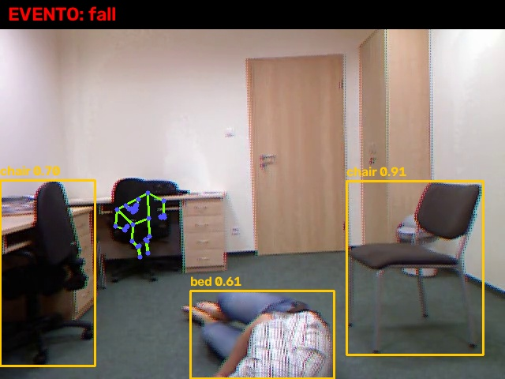

# Relatório técnico — Tech Challenge Fase 4 (FIAP IADT)

**Projeto:** apolo, análise de áudio e vídeo de pacientes com alerta à equipe médica
**Data:** novembro de 2026

## 1. Objetivo e escolhas

O enunciado pede um sistema hospitalar capaz de monitorar pacientes a partir de dados multimodais: vídeos clínicos (com modelos como OpenPose e YOLOv8), gravações de voz (transcrição, termos críticos e sentimento em um serviço gerenciado de nuvem) e alertas automáticos.

Escolhas:

| Tema | Decisão | Por quê |
|---|---|---|
| Entradas | Somente **um arquivo de áudio ou de vídeo** por execução | Preferimos um fluxo bem resolvido de ponta a ponta a vários fluxos pela metade. |
| Nuvem | **OpenAI** para transcrição, classificação do texto, visão e redação do relatório | O enunciado fala em "serviços gerenciados em nuvem, **como** Azure Cognitive Services". A OpenAI oferece o equivalente de cada serviço. |
| Postura | **MediaPipe Pose** no lugar do OpenPose | O OpenPose exige compilação em C++ com CUDA. O MediaPipe Pose instala com `pip`, roda em CPU e devolve 33 pontos do corpo. |
| Áudio | OpenAI: transcreve e classifica o texto | Sem processamento local do áudio. O arquivo vai direto para a API, como está. |
| Interface | Um comando só: `python -m apolo <arquivo>` | Cada execução é independente e cria a própria pasta de saída. |

## 2. Fluxo

```
arquivo (.mp4/.mov/.avi/.mkv/.webm  ou  .wav/.mp3/.m4a/.flac/.ogg)
   │
   ├─ media.py confere a extensão e lê os metadados
   │
   ├─ se for VÍDEO ── video_analysis.py (só as imagens)
   │     ├─ YOLOv8n (ultralytics, CPU): pessoas e objetos em 10 frames por segundo
   │     ├─ MediaPipe Pose Landmarker: 33 pontos do corpo por frame, que viram medidas de postura
   │     ├─ regras de evento: queda, imobilidade, assimetria postural, pessoa fora de quadro
   │     ├─ annotated.mp4: todos os frames com caixas, esqueleto e a faixa do evento ativo
   │     └─ frames/: um frame-chave por evento, que a OpenAI (visão) confirma ou não
   │
   ├─ se for ÁUDIO ── openai_client.py
   │     ├─ OpenAI gpt-4o-transcribe: transcrição
   │     └─ OpenAI gpt-5.4-mini (resposta estruturada): termos críticos, sentimento, indícios, risco
   │
   ├─ scoring.py: soma as evidências → risco 0-100 → INFO / ATENÇÃO / CRÍTICO
   │
   └─ report.py + OpenAI: report.md com a conclusão em linguagem natural; alerta no console a partir de ATENÇÃO
```

## 3. Modelos e serviços

| Dado | Tarefa | Modelo / serviço | Onde roda |
|---|---|---|---|
| Vídeo | Detectar pessoas e objetos | **YOLOv8n** (ultralytics 8.4, pesos COCO) | Local, CPU |
| Vídeo | Estimar a pose (33 pontos) | **MediaPipe Pose Landmarker lite** (mediapipe 1.2) | Local, CPU |
| Vídeo | Detectar eventos | **Regras com limiares fixos** sobre as medidas de postura (seção 3.1) | Local |
| Vídeo | Confirmar e descrever os eventos | **OpenAI gpt-5.4-mini** (entrada de imagem, resposta estruturada) | Nuvem |
| Áudio | Transcrever a fala | **OpenAI gpt-4o-transcribe** | Nuvem |
| Áudio | Termos críticos, sentimento, indícios, risco | **OpenAI gpt-5.4-mini** (resposta JSON validada com pydantic) | Nuvem |
| Relatório | Escrever a conclusão | **OpenAI gpt-5.4-mini** | Nuvem |

Correspondência com os serviços citados no enunciado:

| Enunciado | Implementação |
|---|---|
| Azure Speech to Text | OpenAI `audio/transcriptions` (gpt-4o-transcribe) |
| Azure Text Analytics (termos-chave, sentimento) | OpenAI Responses API com resposta estruturada |
| OpenPose | MediaPipe Pose Landmarker |
| YOLOv8 | YOLOv8n (ultralytics) |

### 3.1 Regras de evento no vídeo

As regras rodam a cada frame analisado (10 por segundo), em cima das medidas de pose:

| Evento | Quando dispara |
|---|---|
| **Queda** | A altura do quadril cai mais de 40 % da altura do corpo em até 1 s, o pico de velocidade dos pontos passa de 0,6 (unidades normalizadas por segundo) e o tronco fica a mais de 30° da vertical. A referência precisa ter o corpo inteiro enquadrado, o que descarta close-ups e cortes de câmera. |
| **Imobilidade prolongada** | A velocidade média dos pontos fica abaixo de 0,04/s por mais de 10 s. |
| **Assimetria postural** | A inclinação média das linhas ombro-ombro e quadril-quadril passa de 20° por mais de 3 s, com a pessoa de frente para a câmera. |
| **Pessoa fora de quadro** | O YOLO não vê ninguém por mais de 3 s depois de ter visto alguém. |

Para a calibração usamos duas sequências do UR Fall Detection Dataset: `fall-01` (queda) e `adl-01` (agachar para pegar um objeto). Na queda, o quadril desce 0,50 da altura do quadro em 1 s com pico de velocidade 0,94. Ao agachar, desce 0,27 em 1,6 s com pico 0,36. É o critério de velocidade que separa os dois casos.

### 3.2 Fusão e severidade

A função `scoring.score` soma pontos por evidência, conforme a tabela `WEIGHTS` no topo de `scoring.py`, com tetos por categoria:

| Evidência | Pontos | Teto |
|---|---|---|
| Queda | 70 | — |
| Imobilidade | 35 | — |
| Assimetria postural | 20 | — |
| Pessoa fora de quadro | 15 | 15 |
| Termo crítico na fala | 8 cada | 32 |
| Indício clínico na fala | 12 cada | 36 |
| Sentimento negativo | 10 | — |
| Risco clínico percebido alto / médio | 20 / 10 | — |
| Evento confirmado pela OpenAI (visão) | 15 | 30 |

Risco = mínimo(100, soma). Severidade: **INFO** abaixo de 30, **ATENÇÃO** de 30 a 69, **CRÍTICO** a partir de 70. O alerta é emitido a partir de ATENÇÃO.

## 4. Resultados

Execuções em CPU (Windows 11, sem GPU), Python 3.11. As amostras estão descritas em `data/samples/SOURCES.md`; os dois casos abaixo são os que ilustram o alerta.

| Amostra | Conteúdo | Achados | Risco | Severidade | Tempo |
|---|---|---|---|---|---|
| `urfd_fall-01.mp4` | Queda real (dataset acadêmico), 5 s, 640x480 | 1 queda em 2,5 s, confirmada pela OpenAI | 85 | **CRÍTICO** | 20 s |
| `sintetico_paciente_dispneia.mp3` | Paciente fictício com falta de ar, 27 s | 6 termos críticos, 5 indícios, sentimento negativo, risco alto | 98 | **CRÍTICO** | 9 s |

O tempo inclui as chamadas à OpenAI.

### 4.1 Queda detectada (`urfd_fall-01.mp4`)



Trecho do `report.md` gerado:

> **Risco:** 85/100 — **CRÍTICO** · **Alerta à equipe médica:** SIM
>
> | Início | Fim | Evento | Descrição | Validação OpenAI |
> |---|---|---|---|---|
> | 00:02.5 | 00:03.5 | fall | Queda: quadril caiu 58% da altura do corpo em 1.0s (velocidade de pico 0.94) e tronco a 33° da vertical | confirmado (risco alto): Há uma pessoa caída no chão, parcialmente deitada de lado/prona próxima à cama, com o corpo fora de postura ereta. A cena é compatível com uma queda. |
>
> Conclusão (OpenAI): "O principal achado foi um evento compatível com queda entre 2,5 e 3,5 segundos, quando foi observada uma pessoa caída no chão, parcialmente deitada de lado/prona, próxima à cama e fora de postura ereta. [...] Recomenda-se intervenção imediata da equipe assistencial, com verificação presencial do paciente, avaliação de possíveis lesões, checagem de consciência e sinais vitais."

A regra é determinística; a validação visual, não. Em outras execuções, com o mesmo frame, a OpenAI respondeu que não conseguia confirmar a queda com clareza, e o risco ficou nos 70 pontos da regra. Em ambos os casos a severidade é CRÍTICO. O frame-chave é salvo 1 s depois da detecção, quando a ação já terminou, para que a OpenAI veja a pessoa no chão e não no meio do movimento. No `annotated.mp4`, a faixa "EVENTO: fall" aparece durante os 3 s seguintes à detecção.

### 4.2 Alterações na fala (`sintetico_paciente_dispneia.mp3`)

Transcrição obtida: "Doutor, desde ontem à noite eu estou com muita falta de ar. Quando eu subo a escada, preciso parar no meio para respirar. Também sinto um aperto no peito e uma tontura quando levanto da cama. Estou muito cansado, não consegui dormir direito. Minha esposa disse que eu estou falando devagar e meio enrolado hoje. Eu não sei, acho que não estou nada bem."

> **Risco:** 98/100 — **CRÍTICO**
> - Sentimento: **negativo** — risco clínico percebido: **alto**
> - Termos críticos: falta de ar, aperto no peito, tontura, muito cansado, falando devagar, meio enrolado
> - Indícios na fala: dispneia aos esforços, aperto no peito, tontura ao levantar, fadiga importante, fala lenta/arrastada
>
> Conclusão (OpenAI): "Recomenda-se avaliação médica imediata, com prioridade para investigação de possível descompensação respiratória ou cardiovascular, além de monitorização contínua e encaminhamento urgente para atendimento presencial."

Os termos e indícios chegaram aos tetos de 32 e 36 pontos, que somados ao sentimento negativo e ao risco alto dão 98.

## 5. Fluxo do alerta à equipe médica

1. `scoring.score` calcula o risco e a severidade.
2. Se a severidade for ATENÇÃO ou CRÍTICO, o alerta é impresso no console com a severidade, o risco, o nome do arquivo e a lista de evidências com os instantes de tempo.
3. O `report.md` traz a conclusão em linguagem natural com a ação recomendada e, no caso de vídeo, o `annotated.mp4` e os frames-chave para uma revisão rápida.

## 6. Limitações

- **Câmera fixa e uma pessoa principal.** Vídeos editados, com cortes e close-ups, geram eventos de "pessoa fora de quadro".
- **Não determinismo do modelo de linguagem.** Termos críticos, sentimento e confirmação visual variam um pouco entre execuções.

## 7. Como reproduzir

```powershell
py -3.11 -m venv .venv
.\.venv\Scripts\Activate.ps1
pip install -r requirements.txt
# baixe models/yolov8n.pt e models/pose_landmarker_lite.task (ver README)
# defina OPENAI_API_KEY no .env
python -m apolo data\samples\urfd_fall-01.mp4
python -m apolo data\samples\sintetico_paciente_dispneia.mp3
```
